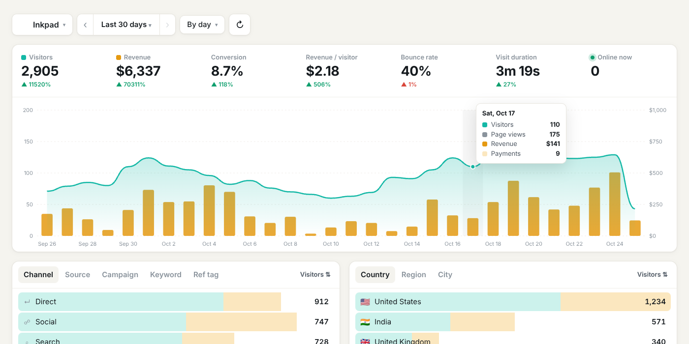
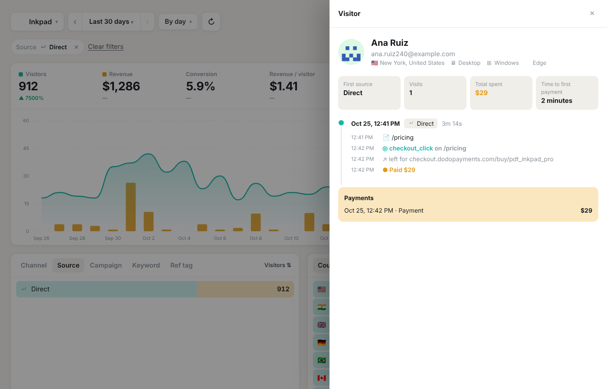

# Tallyline

Self-hosted web analytics that shows **which source made you money**, not just which one sent traffic. See where visitors came from (a specific tweet, a Google page, ChatGPT, a newsletter), what they did, and which visits turned into payments. Runs on Cloudflare's free plan; your data stays in your own account.



## Features

**Numbers at the top** — visitors, revenue, conversion rate, revenue per visitor, bounce rate, visit duration, people online now. Each shows the change against the previous period of the same length.

**Chart** — visitors as a line and revenue as bars, by hour, day, week or month. Click the Visitors / Revenue numbers to show or hide them.

**Date ranges** — today, yesterday, last 24 / 48 hours, 7 / 30 / 90 days, 12 months, all time, or custom dates. ‹ and › move the whole window back and forward.

**Breakdowns** (each row shows visitors and revenue; sort by either)
- Where they came from: channel (Direct, Search, Social, AI, Referral, Email, Paid), source, campaign (`utm_campaign`), keyword (`utm_term`), ref tag (`?ref=`)
- Where they are: country, region, city
- What they looked at: visited pages, landing pages, exit pages, outbound links, hostnames
- What they used: device, browser, OS

**Filters** — click any row and the whole dashboard narrows to it (e.g. only visitors from your launch thread). Filters stack and live in the URL, so a link keeps them.

**Conversions**
- **Revenue journey** — every payment with the buyer, the source credited, the amount, how long they took to buy and how many visits it took
- **Goals** — button clicks and custom events with conversion rate and revenue
- **Funnels** — ordered steps of pages (with `*` wildcards) and goals, with drop-off per step
- **People** — recent visitors with visits, pages, time on site and money spent
- **Visitor timeline** — click anyone to see each visit, page, goal, outbound click and payment in order



**Setup page** — copy-paste snippet, a ready-made prompt for your coding assistant (Claude Code, Cursor…), Dodo Payments connection, server-side API, campaign link builder.

Multiple websites, one login.

## Deploy (about 10 minutes, free)

You need a free [Cloudflare account](https://dash.cloudflare.com/sign-up), [Node.js 20+](https://nodejs.org) and Git.

**1. Get the code and sign in to Cloudflare**

```bash
git clone <your-repo-url> tallyline
cd tallyline
npm install
npx wrangler login
```

**2. Create the database**

```bash
npx wrangler d1 create tallyline
```

If Wrangler offers to add it to your config for you, say **No**. Copy the printed `database_id` into `wrangler.jsonc` in place of `00000000-0000-0000-0000-000000000000`. Keep exactly one entry under `d1_databases`, with `"binding": "DB"`.

**3. Set the dashboard password and the cookie secret**

```bash
npx wrangler secret put DASHBOARD_PASSWORD   # what you'll type to log in; make it strong
npx wrangler secret put COOKIE_SECRET        # any long random text, e.g. from: openssl rand -hex 32
```

If asked whether to create the Worker `tallyline`, say **Yes**.

**4. Deploy**

```bash
npm run deploy
```

This builds the dashboard, creates the tables and deploys. It prints your address, e.g. `https://tallyline.<you>.workers.dev`. Open it, sign in, add a website and copy its snippet.

You can put it on your own domain (e.g. `stats.yourdomain.com`) in Cloudflare → Workers & Pages → tallyline → Settings → Domains & Routes.

**Updating later**

```bash
git stash && git pull && git stash pop   # keeps your database_id edit
npm run deploy
```

### What the free plan covers

| Cloudflare free limit | In practice |
| --- | --- |
| 100,000 Worker requests / day | ~100k tracked events a day across all sites. The tracker script and dashboard files are static and don't count. |
| 100,000 D1 rows written / day | ~10–15k page views a day |
| 5M D1 rows read / day | Hundreds of dashboard loads a day at side-project traffic |
| 5 GB D1 storage | Years of data for most small sites |

At 5–10k visitors a month you'll use a few percent of this. Cloudflare's paid Workers plan is $5/month if you outgrow it.

## Add it to a website

```html
<script defer data-site="PROPERTY_ID" src="https://YOUR-TALLYLINE/t.js"></script>
```

- **Goals:** `<button data-tally="signup_click">`, extra details with `data-tally-plan="pro"`, or from code `tally('event', 'signup', { plan: 'pro' })`
- **Signed-in users:** `tally('identify', { user_id, email, name })`
- **Skip your own visits:** open `https://yoursite.com/?tally_off=1` once per browser (`?tally_off=0` to undo)
- **Single-page apps** (Next.js, React Router, Vue…) are tracked automatically
- **Subdomains** share one visitor: the cookie is set on the root domain
- **Outbound links** are recorded automatically
- Query parameters that may hold personal data (`email`, `name`, `token`, `code`, …) are removed in the browser before anything is sent

Script tag options: `data-endpoint` (send to a proxied path), `data-cookie-domain` (force the cookie domain), `data-allow-local` (track on localhost while testing).

### Tag your posts

X, LinkedIn, Medium and others only reveal the site (`t.co`, `medium.com`), not the exact post. Tag the link in each post; the setup page has a builder:

```
https://yoursite.com/?utm_source=x&utm_medium=social&utm_campaign=launch-thread
https://yoursite.com/?ref=launch-thread
```

Google doesn't share search terms, but **Landing page** filtered to the **Google** source tells you which article people found.

## Revenue with Dodo Payments

1. In Dodo → Developer → Webhooks, add `https://YOUR-TALLYLINE/api/hooks/dodo/PROPERTY_ID`, subscribe to `payment.succeeded` and `refund.succeeded`, and paste the signing secret (`whsec_…`) on the setup page.
2. Put the visitor cookies into the checkout metadata:

```ts
const jar = await cookies(); // next/headers
await dodo.checkoutSessions.create({
  product_cart: [{ product_id: 'pdt_xxx', quantity: 1 }],
  return_url: 'https://yoursite.com/thanks',
  metadata: { tl_uid: jar.get('tl_uid')?.value ?? '', tl_vsn: jar.get('tl_vsn')?.value ?? '' },
});
```

Using Dodo payment links? The tracker adds `metadata_tl_uid` / `metadata_tl_vsn` to every `checkout.dodopayments.com` link on the page. In the browser, `tally.ids()` returns both ids.

3. Recommended: send buyers back to a page on your site that loads the tracker (the return / redirect URL). Dodo appends `?payment_id=…`, and Tallyline uses it to match the payment to the buyer even if metadata got lost.

**Who gets credit:** the buyer's most recent visit that came from a real source (last non-direct touch). Clicked your tweet, came back by typing the URL two weeks later, paid → the tweet gets the revenue.

**When metadata is missing**, Tallyline tries, in order: the return page, an earlier payment by the same customer (renewals and repeat purchases), an email you passed to `identify`, and finally checkout timing — used only when exactly one visitor clicked a Dodo checkout link (or a checkout/buy/purchase goal) in the 3 hours before the payment. The revenue journey shows how each payment was matched, and **Try matching again** re-runs this for unlinked payments and explains the result. Refunds are subtracted from revenue.

### Any other payment provider

```bash
curl -X POST https://YOUR-TALLYLINE/api/v1/payment \
  -H "Authorization: Bearer tl_..." -H "Content-Type: application/json" \
  -d '{"id":"txn_1","amount":29.99,"currency":"USD","uid":"<tl_uid cookie>","email":"ana@company.com"}'

curl -X POST https://YOUR-TALLYLINE/api/v1/conversion \
  -H "Authorization: Bearer tl_..." -H "Content-Type: application/json" \
  -d '{"uid":"<tl_uid cookie>","name":"signup_completed"}'
```

Add `"refund": true` to record a refund, `"renewal": true` for a renewal. The key is on the setup page (and can be rotated).

## Accuracy notes

- **Ad blockers** block some analytics hosts. Proxy `t.js` and `/api/collect` through your own domain (the setup page shows a Next.js rewrite). Payments arrive by webhook, so they're recorded even when the buyer's browser blocked tracking.
- **Safari** keeps script-set cookies for 7 days, so a Safari visitor returning after a week counts as new. The email fallback recovers most of their payments.
- **Bots** are filtered by user agent and by the browser's `navigator.webdriver` flag.
- **Currencies:** a payment in another currency is converted only when Dodo reports a settlement amount in the website's currency.
- **Geography** comes from Cloudflare. If you proxy through Vercel, its `x-vercel-ip-*` headers are used instead; other proxies can forward `x-tallyline-country` / `-region` / `-city`.

## Local development

```bash
cp .dev.vars.example .dev.vars      # password: letmein
npm run migrate:local
npm run build && npm run dev        # http://localhost:8787
npm run dev:ui                      # optional: hot-reloading dashboard on http://localhost:5173

npm run demo-data                   # optional: 30 days of sample data (open /p/demoinkpad)
npm test                            # unit tests
npm run e2e                         # end-to-end checks against the running dev server
```

## How it's built

- `public/t.js` — the tracker, no dependencies (~4 KB gzipped)
- `src/server` — the Cloudflare Worker: a small router, beacon ingest, attribution, Dodo webhook and API, reports on D1 (SQLite)
- `src/common` — the traffic source catalogue shared by server and dashboard
- `src/web` — the dashboard (Preact + Vite, hand-drawn SVG chart, plain CSS with light and dark themes), served as static files by the same Worker
- `migrations/` — database schema

## License

MIT — see [LICENSE](LICENSE).
