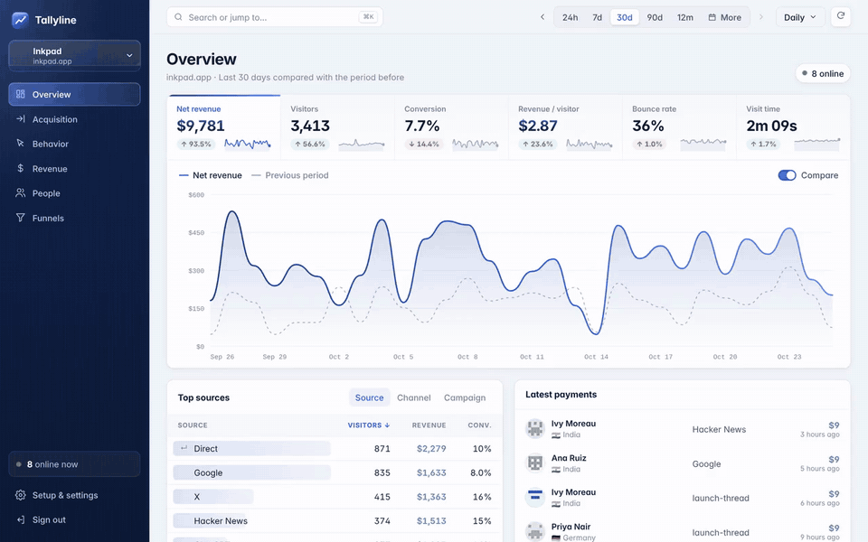
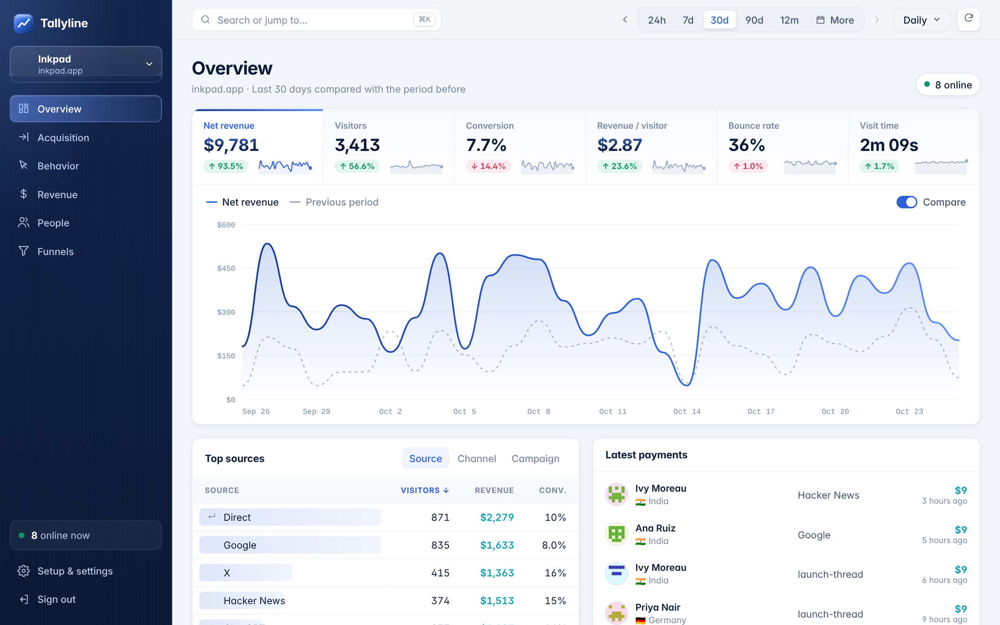
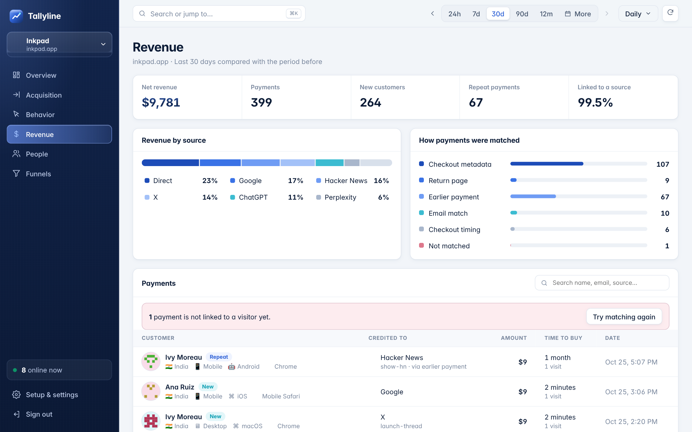
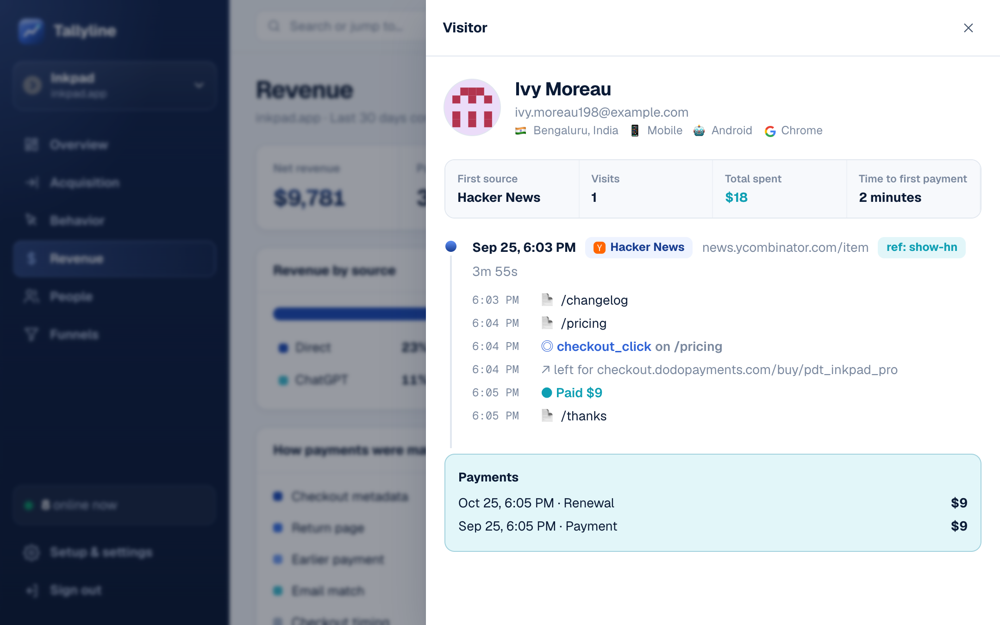
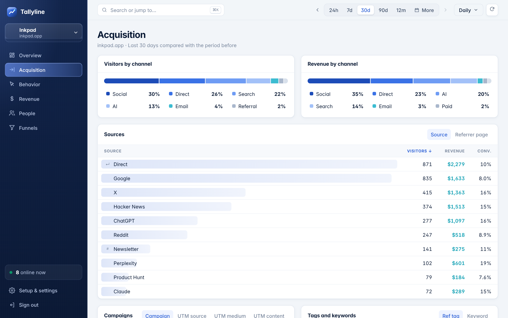
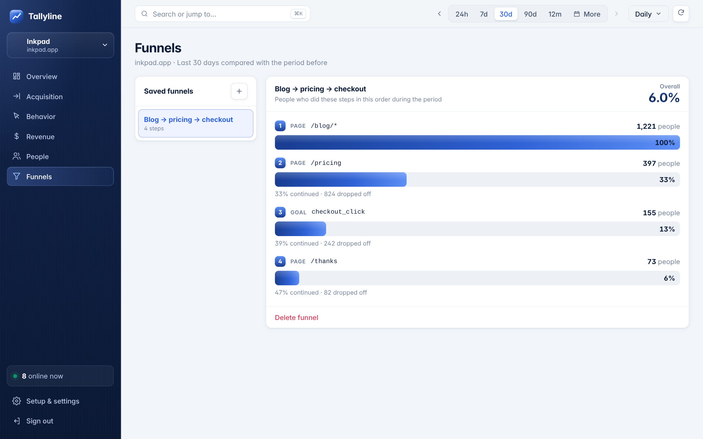
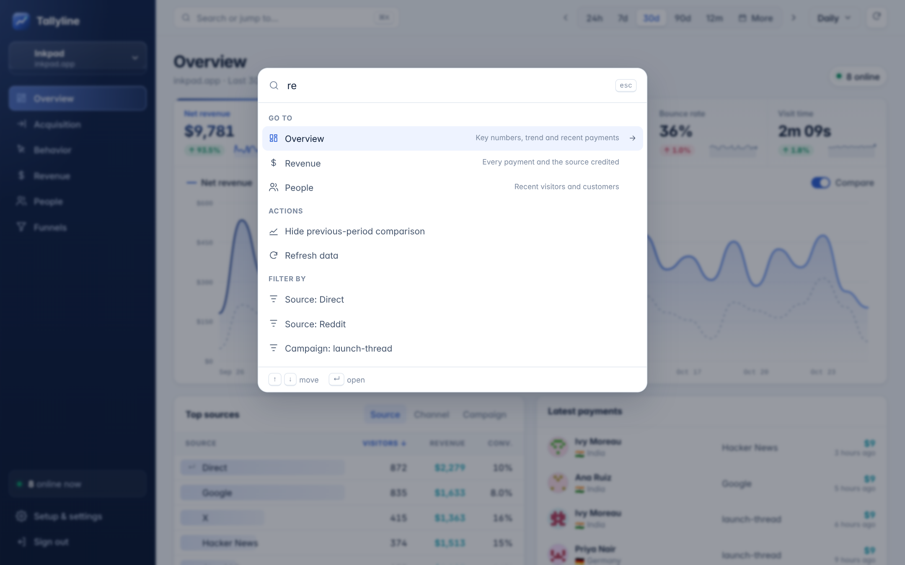
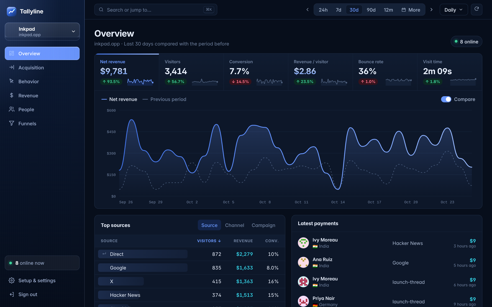
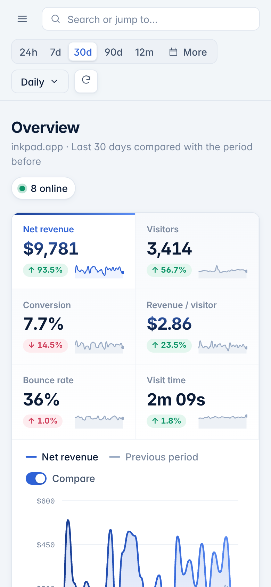

<div align="center">


# Tallyline

**Self-hosted web analytics that shows which source made you money.**

See where every visitor came from (a tweet, a Google page, ChatGPT, a newsletter), what they did, and which visits turned into payments.
Runs on Cloudflare's free plan. Your data stays in your own account.

[Features](#features) · [How it works](#how-it-works) · [Deploy in 10 minutes](#deploy-free-in-about-10-minutes) · [Add to your site](#add-it-to-a-website) · [Revenue](#revenue-attribution)

<br />



<sub>A 30-second tour with sample data. <a href="docs/demo.mp4">Watch the MP4</a>.</sub>

</div>

---

## Why Tallyline

Most analytics tools tell you that 2,000 people came from X last month. They don't tell you that those visitors paid you $1,400, while 3,000 visitors from Google paid $300.

Tallyline connects each payment to the visit that earned it, so every source, campaign, page and goal shows **revenue next to traffic**.

| | Google Analytics | Plausible / Umami | Paid revenue analytics | **Tallyline** |
| --- | :---: | :---: | :---: | :---: |
| Simple, privacy-friendly | | ✓ | ✓ | ✓ |
| Revenue per source and campaign | complex setup | | ✓ | ✓ |
| Full buyer journey per customer | | | ✓ | ✓ |
| AI assistants as a traffic source | | partial | ✓ | ✓ |
| Self-hosted, data in your account | | ✓ | | ✓ |
| Price | free (your data is the price) | paid or self-host | monthly fee | **free** |

## Screenshots

<table>
  <tr>
    <td width="50%"><br /><b>Overview</b>: six headline metrics with sparklines. Click one to chart it against the previous period.</td>
    <td width="50%"><br /><b>Revenue</b>: every payment, the source credited, and how each payment was matched to its buyer.</td>
  </tr>
  <tr>
    <td><br /><b>Visitor timeline</b>: each visit, page, goal, outbound click and payment in order.</td>
    <td><br /><b>Acquisition</b>: channels, sources, campaigns, ref tags and locations, with revenue on every row.</td>
  </tr>
  <tr>
    <td><br /><b>Funnels</b>: page and goal steps with drop-off per step.</td>
    <td><br /><b>⌘K</b>: jump to any view, change the date range or filter by a top source from the keyboard.</td>
  </tr>
  <tr>
    <td><br /><b>Dark mode</b> follows your system setting.</td>
    <td align="center"><br /><b>Works on your phone</b>.</td>
  </tr>
</table>

## Features

**Dashboard**
- Net revenue, visitors, conversion rate, revenue per visitor, bounce rate and visit time, each with % change and a sparkline
- Trend chart for any of those metrics, with the previous period as a dashed line and a hover tooltip comparing both
- Date ranges from the last 24 hours to all time, custom dates, and buttons to step back and forward
- Hourly, daily, weekly or monthly buckets in your website's time zone
- People online right now

**Where visitors come from**
- Channels: Direct, Search, Social, AI, Referral, Email, Paid
- Sources, including Google, X, Reddit, Hacker News, Product Hunt and AI assistants (ChatGPT, Claude, Perplexity, Gemini, Copilot, DeepSeek, Grok)
- Campaigns (`utm_campaign`), keywords (`utm_term`), UTM source/medium/content, `?ref=` tags and full referrer pages
- Country, region and city

**What they do**
- Visited, landing and exit pages, outbound links, hostnames
- Goals from button clicks or code, with conversion rate and revenue
- Funnels with page steps (`*` wildcards) and goal steps
- Device, browser and operating system

**Who paid**
- Every payment with the buyer, credited source, amount, time to buy and number of visits
- A complete timeline for every visitor
- Name and email from `identify()` or from the payment

**Easy to use**
- Click any row to filter every view by it; filters stack and stay in the URL
- ⌘K command palette
- Several websites under one login
- A ready-made prompt that lets Claude Code or Cursor install everything in your codebase

## How it works

<picture>
  <source media="(prefers-color-scheme: dark)" srcset="docs/how-it-works-dark.svg">
  
</picture>

<!-- Diagram source: docs/how-it-works.mmd (rendered to the two SVGs with mermaid-cli, htmlLabels off) -->

1. The tracker sets two first-party cookies: `tl_uid` (the browser) and `tl_vsn` (the current visit, 30 minutes of inactivity ends it).
2. Each visit records where it came from: referrer, UTM tags, `?ref=`, location and device.
3. When a payment arrives, Tallyline finds the browser that paid and **credits the last visit that came from a real source**. Someone who clicks your tweet, comes back by typing your URL two weeks later and pays is credited to the tweet.
4. Every report can then show revenue and customers next to visitors.

## Deploy free in about 10 minutes

You need a free [Cloudflare account](https://dash.cloudflare.com/sign-up), [Node.js 20+](https://nodejs.org) and Git.

```bash
# 1. Get the code and sign in to Cloudflare
git clone https://github.com/LoopGlitch26/tallyline.git
cd tallyline
npm install
npx wrangler login

# 2. Create the database
npx wrangler d1 create tallyline
#    Copy the printed database_id into wrangler.jsonc (replace 00000000-...).
#    If Wrangler offers to add it to your config for you, answer No.

# 3. Set your dashboard password and a cookie secret
npx wrangler secret put DASHBOARD_PASSWORD   # what you'll type to sign in
npx wrangler secret put COOKIE_SECRET        # any long random text: openssl rand -hex 32

# 4. Deploy
npm run deploy
```

The last command prints your address, for example `https://tallyline.<you>.workers.dev`. Open it, sign in, add a website and copy its snippet. You can attach your own domain (such as `stats.yourdomain.com`) in Cloudflare → Workers & Pages → tallyline → Settings → Domains & Routes.

**Updating later:** `git stash && git pull && git stash pop && npm run deploy` (the stash keeps your `database_id` edit).

<details>
<summary>What the free plan covers</summary>

| Cloudflare free limit | In practice |
| --- | --- |
| 100,000 Worker requests / day | About 100k tracked events a day across all sites. The tracker and dashboard files are static and don't count. |
| 100,000 D1 rows written / day | About 10–15k page views a day |
| 5M D1 rows read / day | Hundreds of dashboard loads a day at side-project traffic |
| 5 GB D1 storage | Years of data for most small sites |

At 5–10k visitors a month you use a few percent of this. Cloudflare's paid Workers plan is $5/month if you outgrow it.

</details>

## Add it to a website

```html
<script defer data-site="PROPERTY_ID" src="https://YOUR-TALLYLINE/t.js"></script>
```

| What | How |
| --- | --- |
| Goals without code | `<button data-tally="signup_click" data-tally-plan="pro">` |
| Goals from code | `tally('event', 'signup_completed', { plan: 'pro' })` |
| Signed-in users | `tally('identify', { user_id, email, name })` |
| Skip your own visits | Open `https://yoursite.com/?tally_off=1` once per browser (`?tally_off=0` to undo) |
| Test on localhost | Add `data-allow-local` to the script tag |
| Proxy through your domain | `data-endpoint="/tl/collect"` (the setup page shows the rewrite) |

Single-page apps are tracked automatically. Subdomains share one visitor. Query parameters that may hold personal data (`email`, `name`, `token`, `code` and similar) are removed in the browser before anything is sent.

### Tag your posts

X, LinkedIn and Medium only reveal the site, not the exact post. Tag the link in each post (the setup page has a builder) and it shows up by name, with its revenue:

```
https://yoursite.com/?utm_source=x&utm_medium=social&utm_campaign=launch-thread
https://yoursite.com/?ref=launch-thread
```

## Revenue attribution

### Dodo Payments

1. In Dodo → Developer → Webhooks, add `https://YOUR-TALLYLINE/api/hooks/dodo/PROPERTY_ID`, subscribe to `payment.succeeded` and `refund.succeeded`, and paste the signing secret (`whsec_…`) on the setup page.
2. Pass the visitor cookies into the checkout metadata:

```ts
const jar = await cookies(); // next/headers
await dodo.checkoutSessions.create({
  product_cart: [{ product_id: 'pdt_xxx', quantity: 1 }],
  return_url: 'https://yoursite.com/thanks',
  metadata: { tl_uid: jar.get('tl_uid')?.value ?? '', tl_vsn: jar.get('tl_vsn')?.value ?? '' },
});
```

Using Dodo payment links? The tracker adds the metadata to every `checkout.dodopayments.com` link on the page. In the browser, `tally.ids()` returns both ids.

3. Recommended: send buyers back to a page on your site that loads the tracker. Dodo appends `?payment_id=…`, which links the payment to the buyer even if metadata got lost.

**When metadata is missing**, Tallyline tries, in order: the return page, an earlier payment by the same customer, an email you passed to `identify`, and finally checkout timing (used only when exactly one visitor clicked checkout in the 3 hours before the payment). The Revenue view shows how each payment was matched. **Try matching again** re-runs it for unlinked payments and explains each result. Refunds are subtracted.

### Any other provider

```bash
curl -X POST https://YOUR-TALLYLINE/api/v1/payment \
  -H "Authorization: Bearer tl_..." -H "Content-Type: application/json" \
  -d '{"id":"txn_1","amount":29.99,"currency":"USD","uid":"<tl_uid cookie>","email":"ana@company.com"}'

curl -X POST https://YOUR-TALLYLINE/api/v1/conversion \
  -H "Authorization: Bearer tl_..." -H "Content-Type: application/json" \
  -d '{"uid":"<tl_uid cookie>","name":"signup_completed"}'
```

Add `"refund": true` for a refund or `"renewal": true` for a renewal. The API key is on the setup page and can be replaced at any time.

## Accuracy notes

- **Ad blockers** block some analytics hosts. Proxy `t.js` and `/api/collect` through your own domain. Payments arrive by webhook, so they're recorded even when the buyer's browser blocked tracking.
- **Safari** keeps script-set cookies for 7 days, so a Safari visitor returning after a week counts as new. The email fallback recovers most of their payments.
- **Bots** are filtered by user agent and the browser's `navigator.webdriver` flag.
- **Currencies:** a payment in another currency is converted only when Dodo reports a settlement amount in the website's currency.
- **Location** comes from Cloudflare. Behind Vercel, its `x-vercel-ip-*` headers are used; other proxies can forward `x-tallyline-country` / `-region` / `-city`.

## Local development

```bash
cp .dev.vars.example .dev.vars      # password: letmein
npm run migrate:local
npm run build && npm run dev        # http://localhost:8787
npm run dev:ui                      # optional: hot-reloading dashboard on :5173

npm run demo-data                   # optional: sample data, open /p/demoinkpad
npm test                            # unit tests
npm run e2e                         # end-to-end checks against the dev server
npm run demo                        # single-file demo: server + dashboard + SQLite in the browser
```

## Project layout

| Path | What it is |
| --- | --- |
| `public/t.js` | The tracker, no dependencies (about 4 KB gzipped) |
| `src/server` | The Cloudflare Worker: router, ingest, attribution, Dodo webhook and API, reports on D1 |
| `src/common` | Traffic source catalogue shared by server and dashboard |
| `src/web` | The dashboard (Preact + Vite, hand-drawn SVG charts, plain CSS, light and dark themes) |
| `src/demo` | In-browser demo that runs the real Worker against SQLite compiled to JavaScript |
| `migrations/` | Database schema |

## License

[MIT](LICENSE)
